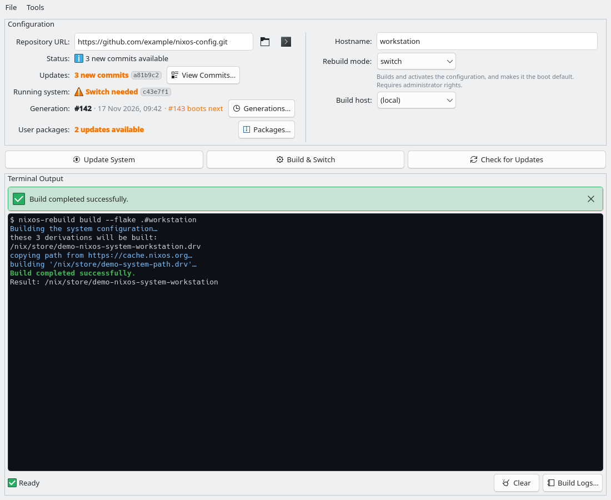
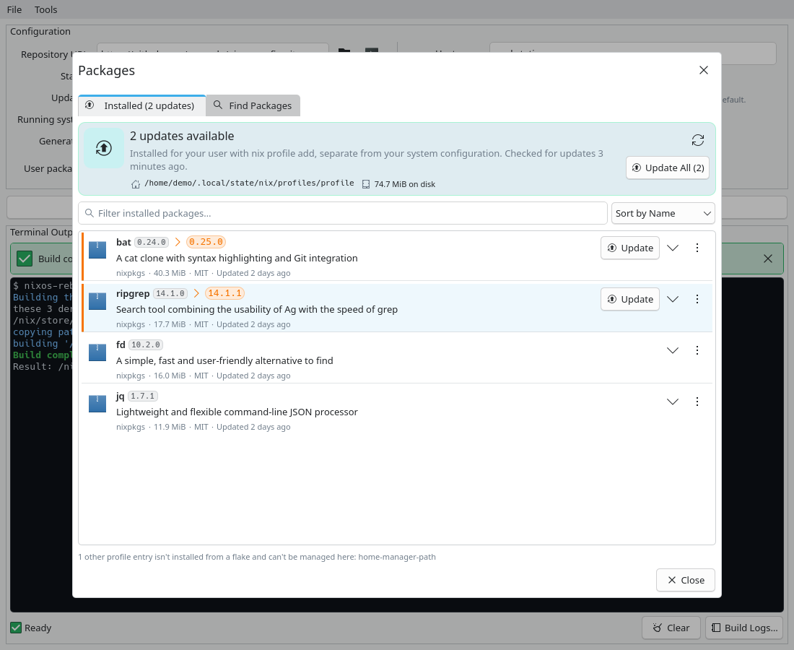
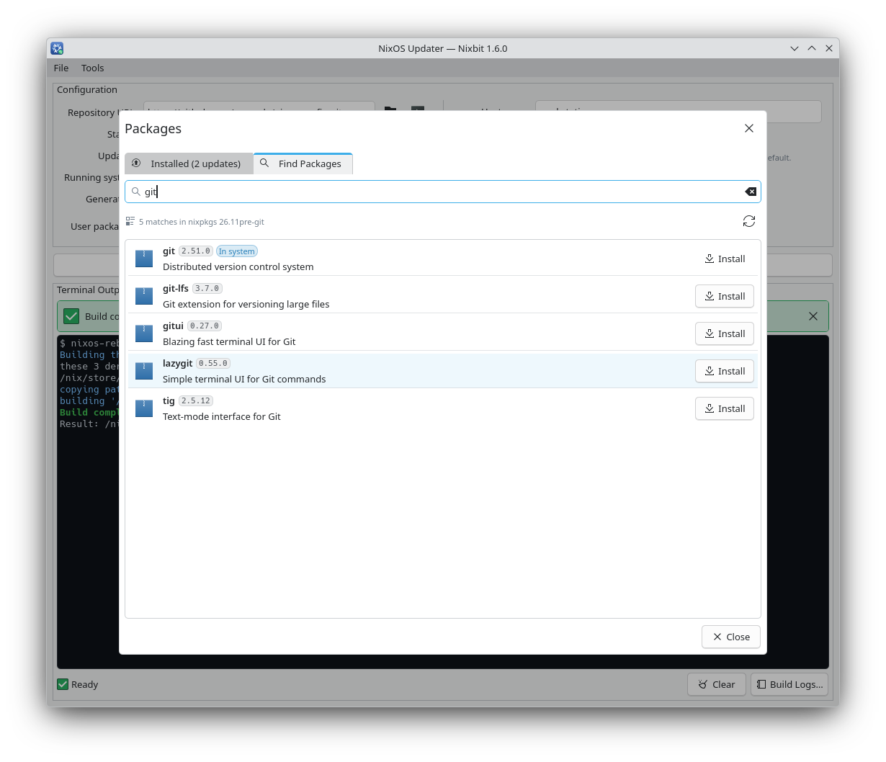
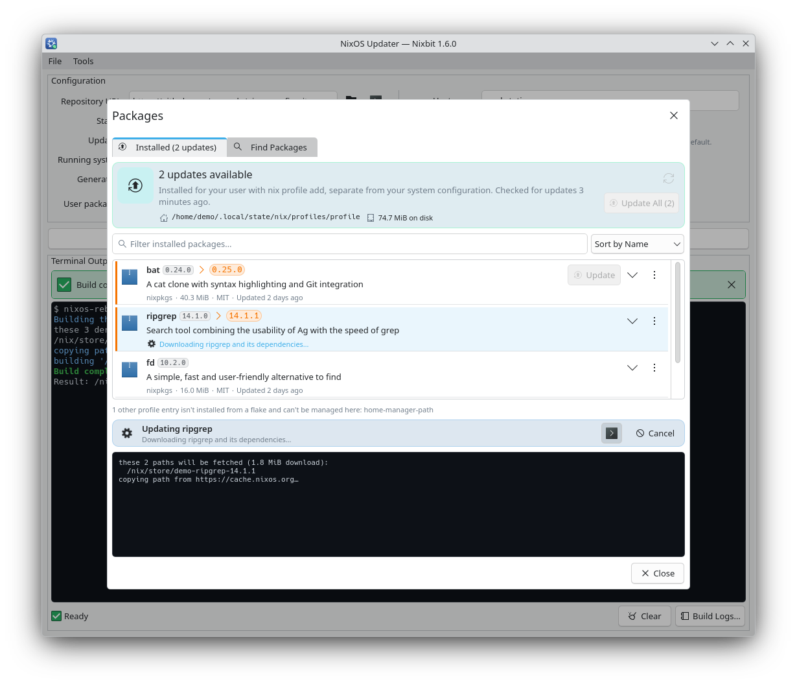
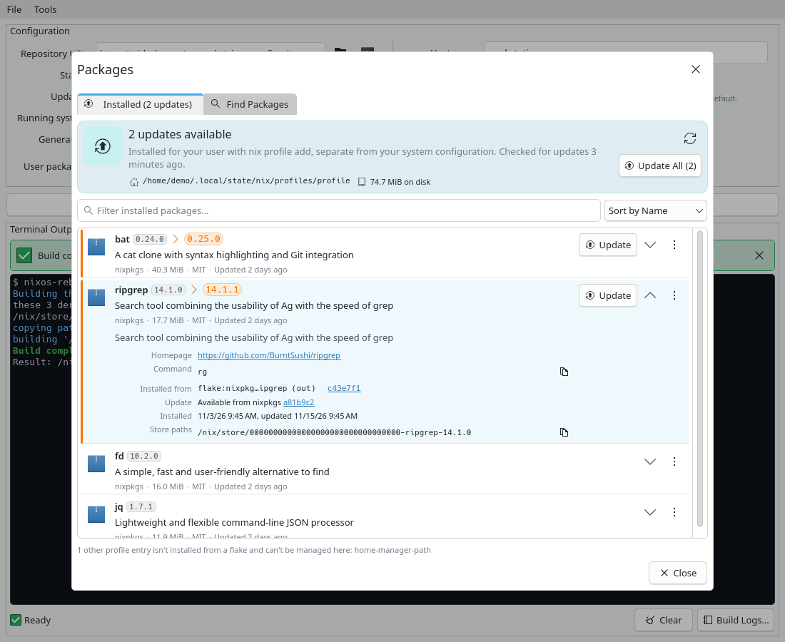

# [Nixbit](https://github.com/pbek/nixbit)

[Changelog](https://github.com/pbek/nixbit/blob/main/CHANGELOG.md) |
[Releases](https://github.com/pbek/nixbit/releases) |
[Issues](https://github.com/pbek/nixbit/issues) |
[Screenshots](screenshots/README.md)

[](https://github.com/pbek/nixbit/actions/workflows/build-nix.yml)

A **GUI application for updating your NixOS system** from a Nix Flakes Git repository,
and for **installing and updating your user packages** with `nix profile`.

- Pull your configuration repository, review the new commits, and build, switch or boot your system
- Find packages in nixpkgs and install them for your user with `nix profile add`,
  without touching your system configuration
- Keep the packages you installed with `nix profile add` up to date, see
  [Installing and Updating User Packages](#installing-and-updating-user-packages)

You can try it out by running:

```bash
nix run github:pbek/nixbit
```

> [!TIP]
> If Qt complains about different minor versions, you can try using your own nixpkgs:
>
> ```bash
> nix run github:pbek/nixbit --override-input nixpkgs nixpkgs
> ```

To run your commands in an embedded [Kwi](https://invent.kde.org/utilities/kwi) terminal
(colored output, Nix progress output and entering passwords), use the `nixbit-kwi` package:

```bash
nix run github:pbek/nixbit#nixbit-kwi
```



> [!NOTE]
> See more [screenshots](screenshots/README.md) showcasing the system monitor and settings dialog.

To automatically capture all important dialogs, including user packages, run
`just screenshots-vm` in an isolated NixOS Plasma VM, or `just screenshots` on
your desktop after building the app. See [automatic screenshots](docs/screenshots.md).

There also is a **NixOS Module** to allow the configuration of the Git repository,
so you can preset it for all systems in your fleet.

## Installing and Updating User Packages

Not every program needs to be part of your system configuration. Packages you only want for
yourself, or only want to try out, can be installed into your user profile with
`nix profile add nixpkgs#<package>`. They are available right away, without a system rebuild,
and don't change your configuration repository. Nixbit lets you find, install, update and remove
these packages without using the command line.

Open the **Packages** dialog with the "Packages…" button next to "User packages" in the main window,
or with "Packages…" and "Find Packages…" in the "Tools" menu. The "User packages" row also shows
how many packages are installed and whether updates are available, and a "Package Updates…" button
appears in the compact view when there are updates.



### Installing Packages

1. Open the **Find Packages** tab and type what you're looking for, either the name of a program
   or what it does, e.g. `json processor`. The results update while you type, with the best matches first.
2. Check the version and description, and whether the package is already installed:
   - **Installed** means it's already in your user profile
   - **In system config**, **In user config** or **In Home Manager** means it's already provided by your
     `environment.systemPackages`, your `users.users.<name>.packages` or Home Manager,
     with the installed version if it differs from nixpkgs
3. Click **Install**. Nixbit runs `nix profile add nixpkgs#<package>` and shows the current step,
   e.g. which package is downloaded or built, next to the package. Show the output of Nix with the
   terminal button, or cancel the installation.

The package is ready as soon as the installation is finished. Open a new terminal to use its commands.



> [!TIP]
> The first search evaluates all packages of nixpkgs once, which takes a minute or two and shows
> its progress. After that, Nix keeps the result in its evaluation cache, so later searches start
> within seconds, even after restarting Nixbit.

If Nix refuses to install a package, Nixbit explains why and offers a fix:

- **Unfree packages**, e.g. `rar`, are only installed if you allow them. Click
  **Allow Unfree and Install** to allow it for this package only (`NIXPKGS_ALLOW_UNFREE=1 … --impure`).
  Updates of unfree packages are allowed automatically.
- **File conflicts** happen if an installed package contains a file of the same name, e.g. `rar` and
  `unrar` both contain `bin/unrar`. Click **Install Anyway** to install the package with a lower
  priority, so the installed package keeps providing the file.

### Updating Packages

Nixbit checks for updates of your packages in the background, about a minute after it starts and then
every six hours, and whenever you open the Packages dialog and the last check is older than an hour.
Click the refresh button in the dialog to check right away.

For each package, Nixbit fetches the newest revision of the flake it was installed from, e.g. `nixpkgs`,
and compares the package it would build with the installed one, like `nix profile upgrade` would.
Packages with updates are listed first and show:

- the **new version**, e.g. `2.12.3 → 2.13.0`
- **Rebuilt** if the version stays the same, but the package changed, e.g. because a dependency was updated

Click **Update** next to a package to update only that package, or **Update All** to update all packages
with `nix profile upgrade --all`. The progress and the output of Nix are shown like when installing.



> [!NOTE]
> Packages are updated to the newest revision of the flake **as your Nix registry resolves it**.
> On NixOS, `nixpkgs` often points to the nixpkgs your system was built from
> (`nixpkgs.flake.setFlakeRegistry`), so your user packages get updates together with your system.
> Packages installed from a pinned revision, e.g. `github:NixOS/nixpkgs/<commit>`, are never updated.

### Package Details

Every installed package shows its version, description, license, disk usage including its dependencies,
the flake it was installed from, and when it was installed or last updated. Click a package to see
its homepage, the command it provides, the exact source revision and its store paths.
Filter the list, and sort it by name, size or last change.

From the menu of a package you can open its homepage or its page on search.nixos.org, copy its
command, install command or store path, and remove it from your profile. You can return to the
previous profile generation with `nix profile rollback` after removing a package by mistake.



> [!NOTE]
> Profiles created with `nix-env` can't be managed with `nix profile`. Entries that weren't
> installed from a flake, e.g. the `home-manager-path` of Home Manager, are listed below the
> packages, but can't be updated in Nixbit.

## NixOS Module

The flake includes a NixOS module to configure nixbit system-wide.
This allows you to manage Nixbit configuration declaratively in your NixOS configuration.

### Basic Usage

```nix
# In your flake.nix inputs
inputs.nixbit.url = "github:pbek/nixbit";
inputs.nixbit.inputs.nixpkgs.follows = "nixpkgs";

# In your NixOS configuration
{
  imports = [ inputs.nixbit.nixosModules.nixbit ];

  nixbit = {
    enable = true;
    repository = "https://github.com/youruser/nixcfg.git";
    notificationCommand = ''notify-send Nixbit "$(cat)"'';
  };
}
```

### Module Options

The module provides the following configuration options:

#### `nixbit.enable`

- **Type**: `boolean`
- **Default**: `false`
- **Description**: Enables the Nixbit module. When enabled, the package will be installed system-wide and configuration will be written to `/etc/nixbit.conf`.

#### `nixbit.package`

- **Type**: `package`
- **Default**: `pkgs.callPackage ./package.nix { }`
- **Description**: The Nixbit package to install. This allows you to override the default package if you want to use a custom build or different version.

#### `nixbit.repository`

- **Type**: `string`
- **Required**: Yes
- **Description**: The Git repository URL that Nixbit will use for system updates. This URL will be written to `/etc/nixbit.conf` and cannot be changed by users through the UI, ensuring consistent configuration across your fleet. Example: `"https://github.com/youruser/nixcfg.git"`

#### `nixbit.forceAutostart`

- **Type**: `boolean`
- **Default**: `false`
- **Description**: When enabled, forces the creation of an autostart desktop entry every time the application starts. This is useful for ensuring Nixbit starts automatically on all systems in your fleet, regardless of user preferences. The setting is written to `/etc/nixbit.conf`.

#### `nixbit.notificationCommand`

- **Type**: `null` or `string`
- **Default**: `null`
- **Description**: Overrides the command used for build, switch, and boot notifications. Nixbit pipes the notification text to the command's standard input. When set, the command cannot be changed through the UI. For example: `''notify-send Nixbit "$(cat)"''`

#### `nixbit.useNh`

- **Type**: `null` or `boolean`
- **Default**: `null`
- **Description**: Whether to use [nh](https://github.com/nix-community/nh) instead of `nixos-rebuild` when commands run in the embedded Kwi terminal (see [Using nh](#using-nh)). When set, the setting cannot be changed through the UI. When `null`, users choose in the settings. The setting is written to `/etc/nixbit.conf` (in the `[General]` section with `UseNh` key).

### What the Module Does

When the module is enabled, it:

1. **Installs the package**: Adds the Nixbit package to `environment.systemPackages`, making it available system-wide
2. **Creates configuration file**: Generates `/etc/nixbit.conf` with:
   - The specified repository URL (in the `[Repository]` section with `Url` key)
   - The autostart force setting (in the `[Autostart]` section with `Force` key)
   - The optional notification command (in the `[Notifications]` section with `Command` key)
3. **Locks settings**: Any settings written to `/etc/nixbit.conf` cannot be modified through the Nixbit UI, ensuring your fleet configuration remains consistent

## Configuration Revision

A pulled repository doesn't mean the new configuration is running yet. To tell
whether the running system was built from the latest fetched commit, Nixbit
reads the configuration revision of `/run/current-system` with
`nixos-version --configuration-revision`. Your flake needs to embed this
revision into every host configuration, for example in a module shared by all
hosts:

```nix
{
  outputs =
    { self, nixpkgs, ... }:
    {
      nixosConfigurations.my-host = nixpkgs.lib.nixosSystem {
        modules = [
          ./configuration.nix
          { system.configurationRevision = self.rev or self.dirtyRev or null; }
        ];
      };
    };
}
```

With the revision in place, the main window and the tray icon show:

- **Up to date** (green check mark): the running system was built from the latest fetched commit
- **Switch needed** (orange arrow): the repository is up to date, but the running system was built
  from another commit, e.g. after a build or a boot rebuild that wasn't activated yet

The "Updates" row shows the latest fetched commit, and the "Running system" row
the commit the running system was built from. Hover over them for an
explanation of the status; the tray icon tooltip shows both commits as well.
Click a commit hash to open the commit on the Git forge (GitHub, GitLab,
Codeberg, Forgejo, Gitea, Bitbucket and SourceHut are supported).

Without a revision, or if the system was built with uncommitted changes, Nixbit still works as usual,
but can only check the repository. The running system is then shown as **Not verified**, and the
tray icon shows a gray instead of a green check mark when the repository is up to date.

## Privilege Escalation (pkexec / sudo)

The `switch` and `boot` rebuild modes need root privileges. Nixbit resolves a
privilege escalation tool at run time:

1. It prefers a **setuid `pkexec`** (for example the NixOS wrapper at
   `/run/wrappers/bin/pkexec`), which shows a graphical authentication dialog.
2. If no setuid `pkexec` is available, it falls back to a **setuid `sudo`**,
   using a graphical askpass helper (such as `ksshaskpass`) when one is found.

### Enabling pkexec on NixOS

On NixOS, binaries in the Nix store cannot be setuid; a setuid **wrapper** must
be created instead. Enabling polkit alone is **not** enough — NixOS does not
create a setuid `pkexec` wrapper by default, so `pkexec` will fail with
`pkexec must be setuid root` and Nixbit will use the `sudo` fallback.

To use `pkexec`, declare the wrapper explicitly in your NixOS configuration:

```nix
{ pkgs, ... }:
{
  # Enable polkit and a polkit authentication agent for your desktop.
  # (KDE Plasma already runs polkit-kde-agent.)
  security.polkit.enable = true;

  # Create a setuid wrapper for pkexec, since NixOS does not ship one.
  security.wrappers.pkexec = {
    owner = "root";
    group = "root";
    setuid = true;
    source = "${pkgs.polkit.bin}/bin/pkexec";
  };
}
```

After `nixos-rebuild switch` (and re-login, or reboot), `/run/wrappers/bin/pkexec`
will exist as a setuid root binary, and Nixbit will automatically prefer it over
`sudo` — no Nixbit configuration change is required.

> [!NOTE]
> `pkexec` does not cache credentials the way `sudo` does, so it authenticates
> separately for each privileged action. The `sudo` fallback may reuse a cached
> credential within its timeout.

### Using nh

When commands run in the embedded Kwi terminal, Nixbit can use
[nh](https://github.com/nix-community/nh) instead of `nixos-rebuild`. Turn on
**Use nh for building, switching and booting** in the General settings.

Nixbit then runs `nh os build|switch|boot . --hostname <host>` in your repository
as your user. nh only elevates for the activation and asks for your password in
the terminal, so no `pkexec` or `sudo` askpass setup is needed. `nh` has to be
in your `PATH`, for example via `programs.nh.enable = true;` on NixOS.

The **Build & Switch** button is hidden while nh is used, because a switch with
nh already builds first and only asks for your password once the build
succeeded. To build on a remote host, select it as the host for the switch mode.

## Features

### 🔄 NixOS Generations

- **Running Generation Display**: Shows the number and date of the running generation next to the running system status,
  and which generation boots next if a boot rebuild made another generation the boot default
- **Generation History**: The "Generations…" button opens a dialog with the complete generation history,
  including the NixOS and kernel version, and the commit each generation was built from (see [Configuration Revision](#configuration-revision))
- **Generation Management**: Manual refresh capability and automatic refresh after "switch" and "boot" operations,
  and when the running system changes
- **Visual Indicators**: The generation list marks the running generation and the boot default

### 🧩 User Packages

Install, update and remove the packages of your user profile with `nix profile`, without rebuilding
your system. See [Installing and Updating User Packages](#installing-and-updating-user-packages)
for a walkthrough.

- **Package Search**: Search all packages of nixpkgs by name or description while you type,
  and install them with `nix profile add nixpkgs#<package>`
- **Already Installed Packages**: Search results mark packages that are already in your profile,
  your system or user configuration, or Home Manager
- **Package Updates**: Automatic and manual update checks against the newest revision of each package's flake,
  showing the new version or whether a package was only rebuilt; update single packages or all at once
- **Installed Packages**: Version, description, license, disk usage, source flake and revision,
  and install and update dates of every package, with filtering and sorting
- **Progress and Errors**: The current download or build step, the output of Nix, cancellation,
  and one-click fixes for unfree packages and file conflicts
- **Status at a Glance**: The main window shows the number of packages and available updates,
  and the tray icon shows the activity while packages are installed, updated or removed

### 📦 Repository Management

- **Repository URL Configuration**: Input field for Git repository URLs with confirmation dialog for changes
- **Local Repository Management**: Local path displayed in Settings Dialog, delete repository with safety checks and confirmation
- **Repository Quick Access**: "Open in file manager" and "Open terminal" buttons for direct access to repository folder (supports multiple terminal emulators: konsole, gnome-terminal, xfce4-terminal, alacritty, kitty, ghostty, xterm)
- **Status Monitoring**: Real-time display of repository status, commits behind, and busy indicators
- **Auto-fetch Interval**: Configurable automatic fetch interval in minutes
- **Network Resilience**: Waits for network availability after system resume before checking for updates (10-second timeout)
- **Smart Refresh**: Automatically checks for repository updates when window becomes visible or is unhidden
- **Commit Review Dialog**: Review the commits that are not pulled yet before deciding whether to update
  - Opens from the commit count and the "View Commits" button in the main window, the "View New Commits" entry
    in the tray menu, the "Tools" menu and the right-click menu of the "Updates" row, and the notification about new commits
  - Commits are grouped by day, with the author, relative time, changed files and added and removed lines
  - Expand a commit to read its full message, and filter commits by message, author or hash
  - Open each commit on the Git forge (GitHub, GitLab, Codeberg, Forgejo, Gitea, Bitbucket, SourceHut),
    or compare all new commits at once where the forge supports it
  - Update the system, or pull without rebuilding, directly from the dialog

### 🚀 System Update

- **Hostname Configuration**: Input field for NixOS system hostname with automatic sanitization
- **Rebuild Mode Selection**: Choose between 'build' (no activation) and 'switch' (build and activate) modes with descriptive explanations
- **Build Host Management**: Configure multiple build hosts with friendly names and SSH addresses in Settings Dialog
- **Build Host Selection**: Choose between local or remote build hosts for each rebuild mode independently
- **Dynamic Button Labels**: Main action button reflects selected mode ("Build System" or "Switch System")
- **Build & Switch**: Chain build and switch operations - builds remotely first, then switches locally if successful (hidden when [nh](#using-nh) is used)
- **Update System**: One-click button to pull repository updates and rebuild the system
- **Check for Updates**: Button to manually check for repository updates
- **Process Control**: Pause and resume system update processes during builds (hidden in switch and boot mode due to sudo limitations, unless [nh](#using-nh) is used)

### 📊 System Monitoring

- **CPU Usage**: Real-time CPU utilization display during builds
- **Memory Usage**: Current RAM usage with used/available memory information
- **Network Transfer**: Upload and download rates during system updates
- **Disk I/O**: Read/write rates for all physical disks (NVMe, SATA, SCSI, virtio, IDE, MMC/SD)
- **System Load**: Current system load average monitoring

### 🎨 User Interface

- **Modern KDE Integration**: Built with Kirigami for native KDE Plasma look and feel
- **Menu Bar**: File menu with Quit option, Tools menu with Check for Updates, Packages and Find Packages
- **Action Buttons**: Quick access to system update and update check operations
- **Terminal Output Panel**: Real-time command output display with syntax highlighting and interactive features
  - Success messages highlighted in green (e.g., "Done. The new configuration is", "Process finished with exit code: 0")
  - Error messages highlighted in red and bold (e.g., "error:", "failed", non-zero exit codes)
  - Warning messages highlighted in yellow/orange
  - Build activity messages highlighted in cyan (e.g., "building", "copying", "evaluating")
  - Process status markers highlighted in magenta and bold (e.g., "=== Process finished ===")
  - Text selection with mouse and keyboard (Ctrl+C to copy, Ctrl+A to select all)
  - Right-click context menu with Copy, Select All, and Deselect options
  - Output buffer limiting (last 5,000 lines by default, configurable 500-20,000) to prevent memory issues
  - Clear and kill process buttons
- **Build Logs Management**: "View Logs" button to access past build logs
  - Stores last 10 build logs by default (configurable 0-100, 0 = unlimited)
  - Shows timestamp, build type (BUILD/SWITCH), exit status, and file size
  - Open logs in default editor or delete with confirmation
  - Logs stored in `~/.local/share/nixbit/logs/` directory
- **Build Status Messages**: Clear feedback after builds
  - Green success message ("✓ Build completed successfully!") when exit code is 0
  - Red error message with exit code ("✗ Build failed with exit code N") when build fails
  - Messages persist until dismissed or next action
- **Progress Indicators**: Progress bar for cloning operations and busy indicators for ongoing tasks
- **System Tray Support**: Option to start the application hidden in the system tray
  - Tray icon reflects update status (up to date, updates available, switch needed, not verified, unknown)
  - An animated badge is shown while the repository is updated or a command is running
  - The running system is compared with the latest fetched commit (see [Configuration Revision](#configuration-revision))
  - Debug mode uses different colors for easier identification (cyan, darker orange, purple)
- **Autostart Option**: Checkbox to create or remove autostart desktop entry
- **Settings Dialog**: KDE System Settings-style interface with vertical category menu
  - Categories: General, Performance, Repository, Build Hosts
  - Split-view layout (900x600) for better organization
  - Performance settings: Max Terminal Lines (500-20,000), Max Stored Logs (0-100)
  - Repository settings: Local path display with delete option
  - Build Hosts: Create, update, delete host configurations with inline editing
- **Confirmation Dialogs**: Safety prompts for deleting repositories and changing URLs
- **Status Notifications**: Inline messages for operation results and errors
- **Window State Persistence**: Window size and position remembered across sessions
- **Automatic Data Refresh**: When window becomes visible, automatically checks for repository updates and refreshes generations list
- **Debug Mode**: `--debug` CLI argument for testing with separate settings directory and default build mode

## 🛠️ Technology Stack

- **Language**: C++ (Qt6)
- **UI Framework**: QML with KDE Kirigami
- **Build System**: CMake 3.20+
- **Dependencies**:
  - Qt6 (Core, Gui, Qml, Quick, Widgets)
  - KDE Frameworks 6
  - KF6 Kirigami
  - Git (runtime dependency)

## 🔨 Building

### Prerequisites

This project uses `devenv` for a reproducible development environment with all necessary dependencies:

```bash
# Enter the development shell
devenv shell

# Or use direnv (if configured)
direnv allow
```

### Using Just Recipes

The project provides Just recipes for common build and development tasks:

```bash
# Configure the project with CMake
just build

# Run the application
just run

# Build the nix package
just nix-build

# Run the application from the nix package
just nix-run
```

## 📄 License

See [LICENSE.md](LICENSE.md) for details.

## 🤝 Contributing

This is an early-stage project. Contributions are welcome!

> [!NOTE]
> This project was developed with AI assistance.

---

Built with ❤️ for the NixOS community
